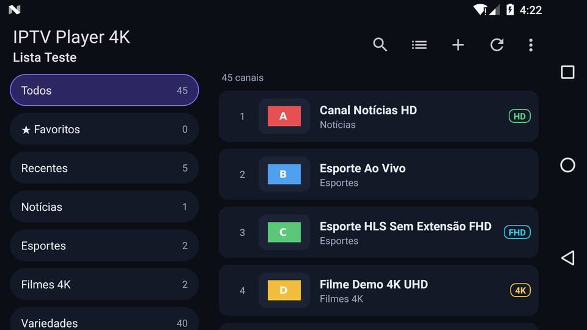
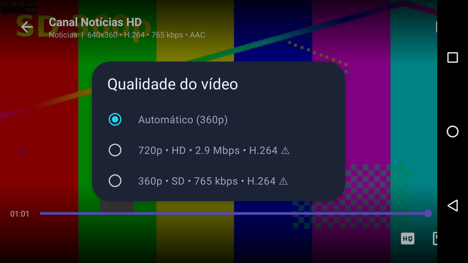

# IPTV Player 4K (Android)

Player de listas IPTV para **celular, tablet, Android TV e TV Box**, com reprodução
em **SD, HD, Full HD e 4K** (incluindo HDR10/HLG/Dolby Vision quando o aparelho suporta).

> O app não contém canais. Use apenas listas às quais você tem direito.

| Lista (TV / paisagem) | Player 4K | Seletor de qualidade |
|---|---|---|
|  |  |  |

## Instalar

1. Baixe o APK `IPTV-Player-4K-v1.0.0.apk` (pasta `release/`).
2. No Android, permita "Instalar apps desconhecidos" para o navegador/gerenciador de arquivos.
3. Abra o APK e instale. Na Android TV / TV Box, copie o APK via pendrive ou use
   um app como *Downloader* / *Send Files to TV*.

Requisitos: Android 5.0 (API 21) ou superior.

## Recursos

**Listas**
- Link M3U / M3U8 (`http://…/lista.m3u`)
- Login **Xtream Codes** (servidor + usuário + senha, saída MPEG-TS ou HLS)
- Arquivo `.m3u` do aparelho
- Várias listas salvas, atualização manual, User-Agent configurável por lista
- Parser tolerante: `tvg-logo`, `group-title`, `#EXTGRP`, `#EXTVLCOPT` (user-agent/referrer),
  `#EXTHTTP` e cabeçalhos estilo Kodi (`url|User-Agent=…`)

**Navegação**
- Grupos/categorias com contagem, Todos, ★ Favoritos e Recentes
- Busca instantânea (ignora acentos)
- Logos dos canais e selo de qualidade (4K/FHD/HD/SD) detectado pelo nome
- Toque longo (ou OK longo no controle) para favoritar
- Layout lateral em TV/paisagem, navegável pelo D-pad

**Player (Media3 / ExoPlayer)**
- HLS, MPEG-TS, DASH, SmoothStreaming, RTSP, MP4/MKV
- Detecção automática do formato (tenta HLS se a URL não tiver extensão)
- Selo de resolução ao vivo (SD/HD/Full HD/4K + HDR) com codec, fps e bitrate
- Seletor de **qualidade**, **faixa de áudio** e **legendas**
- Sem limite pela resolução da tela: chega a 4K quando a banda permite
- Reconexão automática em quedas de rede
- Troca de canal: botões ◀ ▶, CH+/CH−, ou ▲/▼ no controle remoto
- Proporção: ajustar / zoom / esticar
- Picture-in-Picture (Android 8+)

**Configurações**
- Forçar sempre a qualidade máxima
- Buffer maior para internet instável
- Mudar a TV para 4K automaticamente ao abrir conteúdo 4K
- Menu *Compatibilidade 4K do aparelho*: mostra se o aparelho decodifica HEVC/H.264/AV1/VP9
  em 4K e quais formatos HDR a tela suporta

## Compilar

Requer JDK 17+ e Android SDK (platform 35).

```bash
cd iptv-player
./gradlew testDebugUnitTest assembleRelease
# APK: app/build/outputs/apk/release/app-release.apk
```

Sem `keystore.properties`, o APK release é assinado com a chave de debug. Para publicar com
a sua própria chave, crie `iptv-player/keystore.properties`:

```properties
storeFile=minha-chave.jks
storePassword=****
keyAlias=iptv
keyPassword=****
```

O workflow `.github/workflows/android-iptv-apk.yml` compila o APK no GitHub Actions a cada push
(o arquivo fica em *Actions → execução → Artifacts*).

## Estrutura

```
app/src/main/java/com/iptv/player4k/
├── App.kt                    # Coil (logos) com OkHttp compartilhado
├── data/
│   ├── M3uParser.kt          # parser M3U/M3U8 estendido
│   ├── Playlist.kt           # modelo de lista (URL, Xtream, arquivo)
│   ├── PlaylistRepository.kt # download + cache local
│   ├── PlaylistStore.kt      # listas, favoritos, recentes, ajustes
│   └── Channel.kt            # canal + selo de qualidade
├── ui/                       # tela de listas/grupos/canais
├── player/PlayerActivity.kt  # ExoPlayer, qualidade, PiP, controle remoto
└── util/                     # rótulos de vídeo, diagnóstico 4K
```
