# IPTV Player 4K (Android)

Player de listas IPTV para **celular, tablet, Android TV e TV Box**, com reprodução
em **SD, HD, Full HD e 4K** (incluindo HDR10/HLG/Dolby Vision quando o aparelho suporta).

> O app não contém canais. Use apenas listas às quais você tem direito.

| Tela inicial (TV) | Celular: validade, novidades e esportes | Trocar de grupo sem sair do canal |
|---|---|---|
| 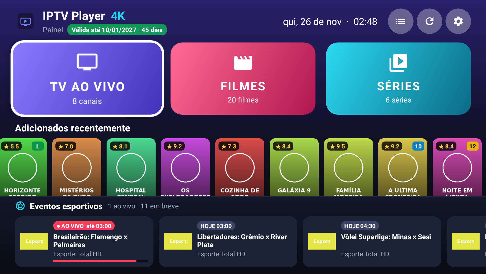 | 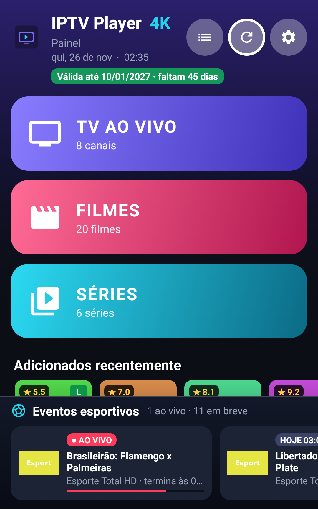 | 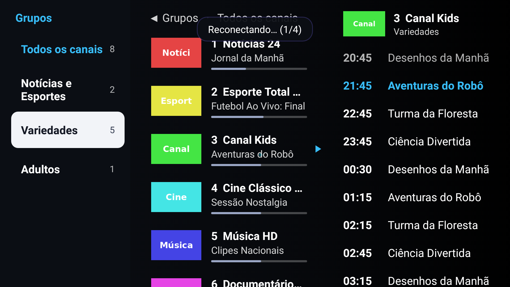 |

| Filmes (destaque) | Guia de programação | Ao vivo com EPG |
|---|---|---|
| 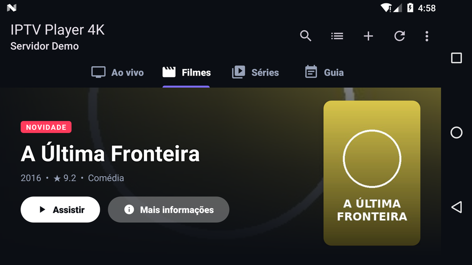 | 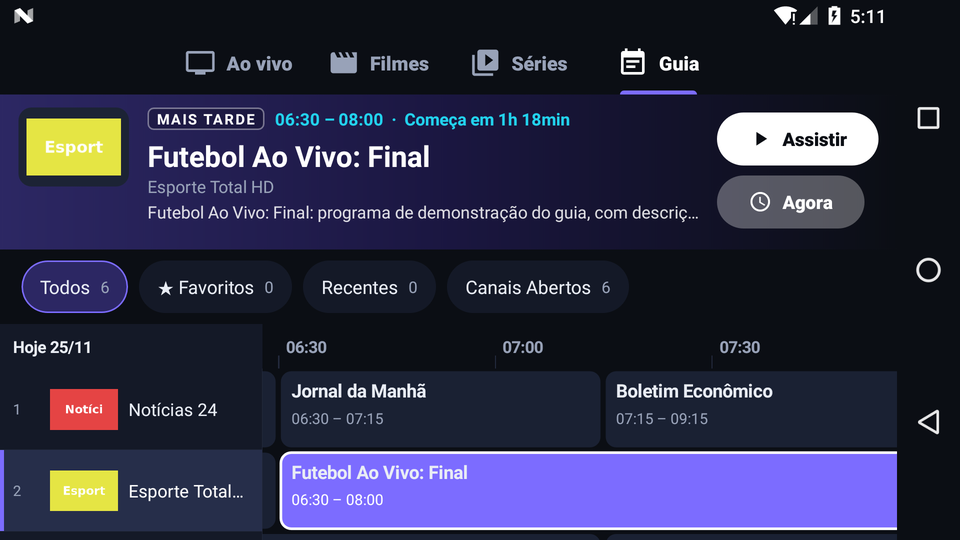 | 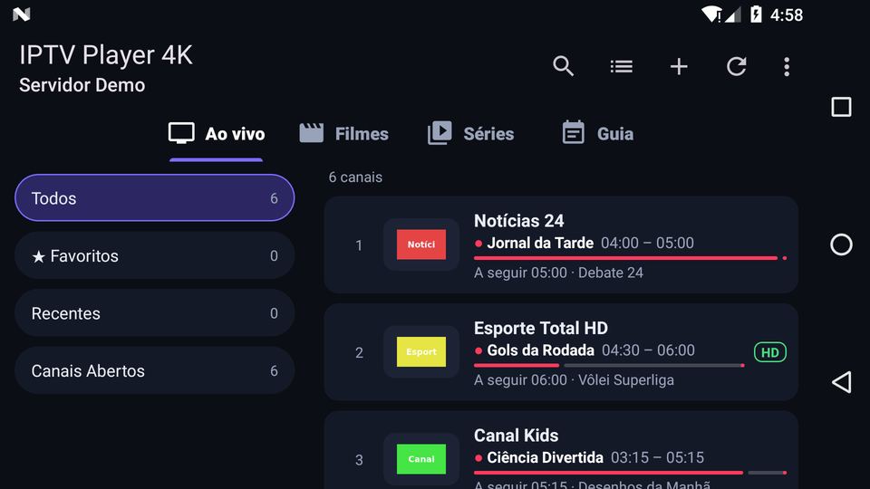 |
| **Fileiras por categoria** | **Série: temporadas e episódios** | **Player com guia** |
| 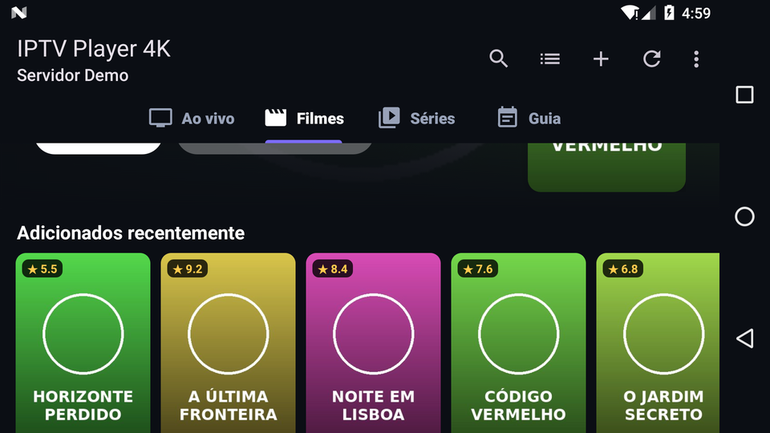 | 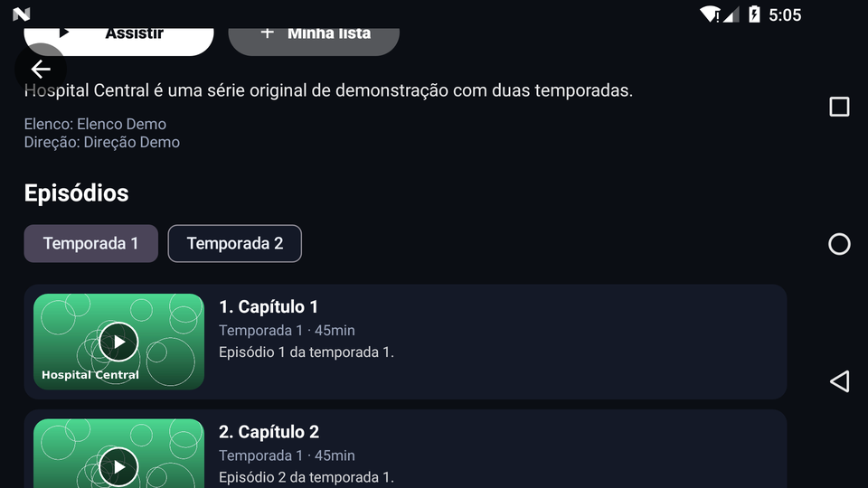 | 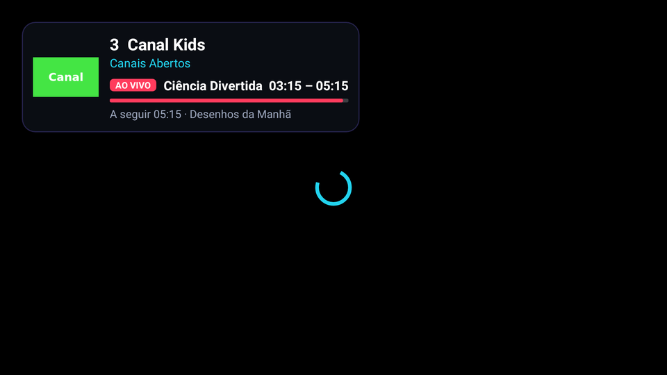 |

| Multi-tela | Controle dos pais | Grupos e classificação |
|---|---|---|
| 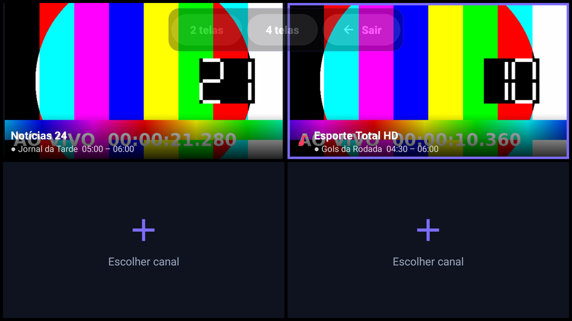 | 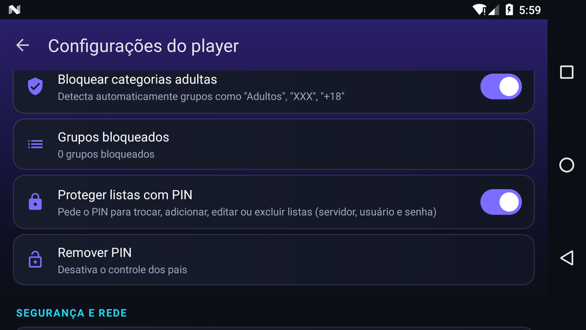 | 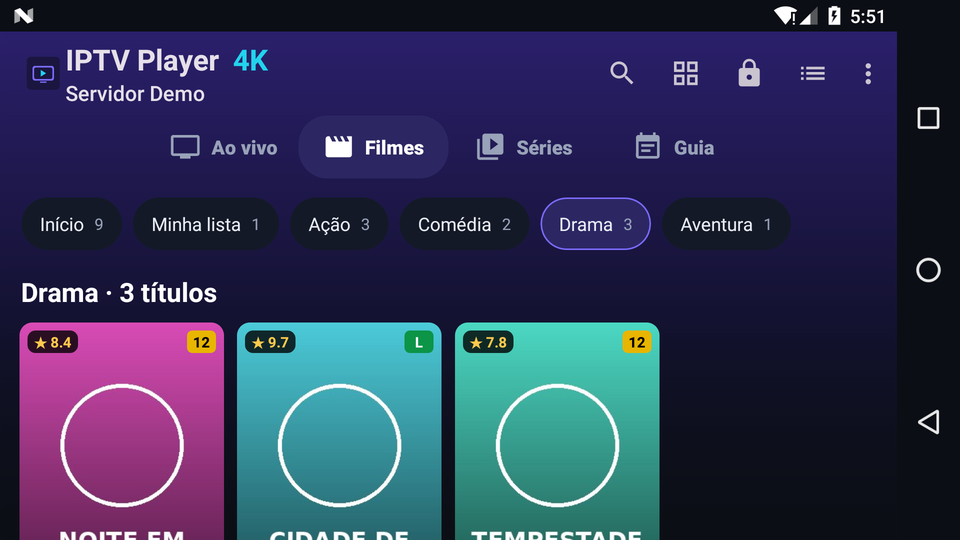 |

| Celular: Filmes | Celular: Guia | Player 4K |
|---|---|---|
| 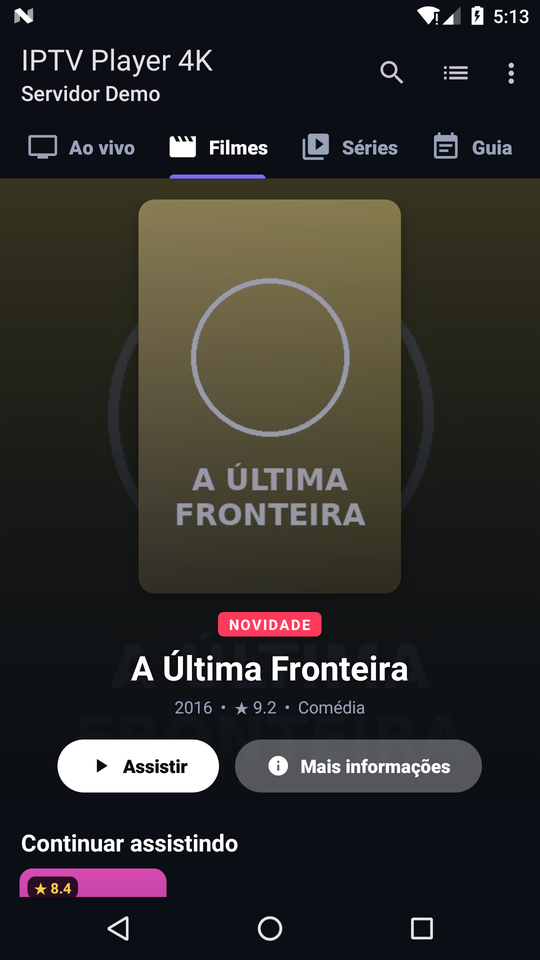 | 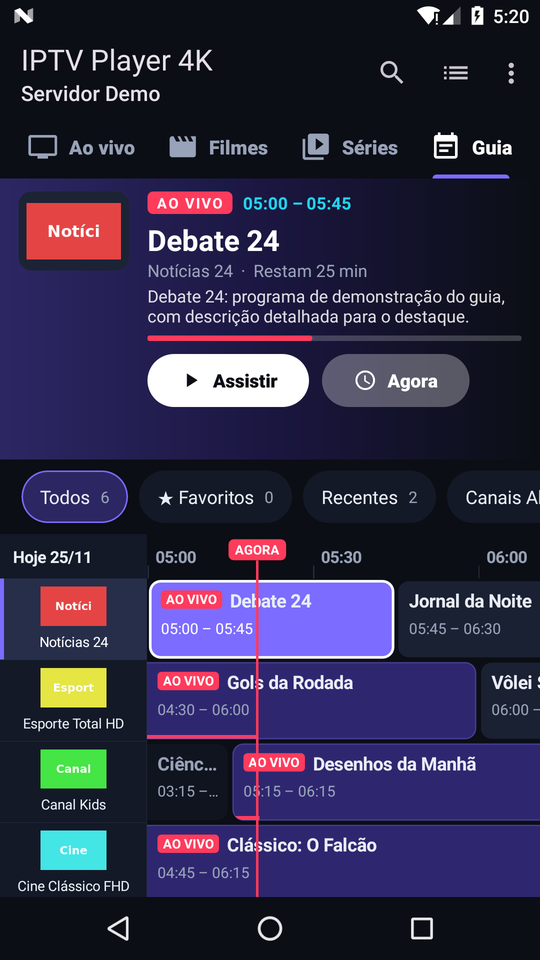 | 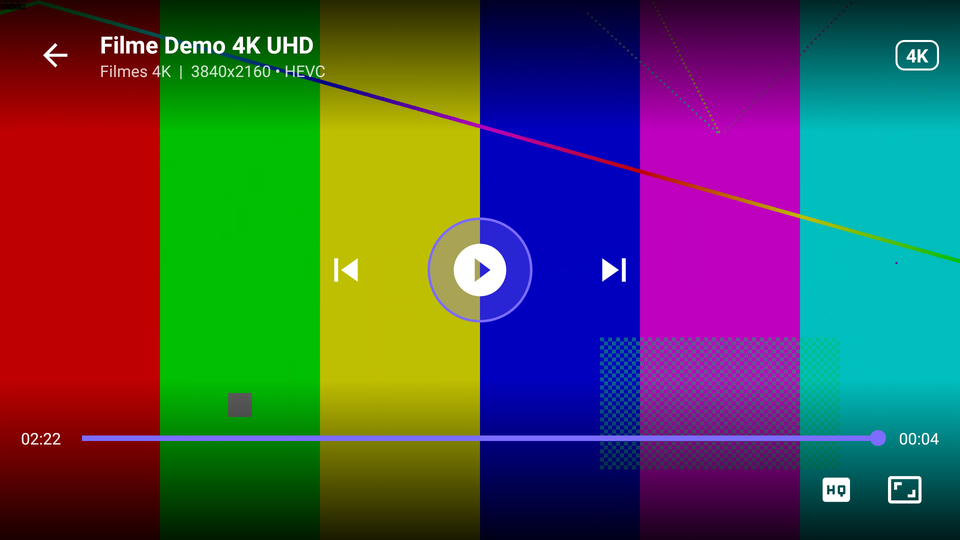 |

## Instalar

1. Baixe o APK `IPTV-Player-4K-v1.4.0.apk` (pasta `release/`).
2. No Android, permita "Instalar apps desconhecidos" para o navegador/gerenciador de arquivos.
3. Abra o APK e instale. Na Android TV / TV Box, copie o APK via pendrive ou use
   um app como *Downloader* / *Send Files to TV*.

Requisitos: Android 5.0 (API 21) ou superior.

## Recursos

**Listas**
- Link M3U / M3U8 (`http://…/lista.m3u`)
- Login **Xtream Codes** (servidor + usuário + senha, saída MPEG-TS ou HLS)
- Arquivo `.m3u` do aparelho
- Várias listas salvas, atualização manual, User-Agent configurável por lista
- Parser tolerante: `tvg-logo`, `group-title`, `#EXTGRP`, `#EXTVLCOPT` (user-agent/referrer),
  `#EXTHTTP` e cabeçalhos estilo Kodi (`url|User-Agent=…`)

**1.4.0 — tela inicial com esportes, novidades e validade**
- Rodapé **Eventos esportivos**: jogos e transmissões encontrados no guia (EPG) da lista,
  ao vivo (com progresso e horário de término) e os que começam nas próximas 24 h.
  Evento ao vivo: OK/toque abre **direto no canal**; evento futuro avisa dia, hora e canal
- Fileira **Adicionados recentemente** com filmes e séries mais novos (data do painel Xtream;
  em listas M3U, os últimos itens da lista)
- **Validade da lista** no topo (painel Xtream): data de vencimento e dias que faltam,
  em verde, amarelo (≤ 15 dias) ou vermelho (≤ 3 dias / vencida); "sem vencimento" e
  "não informada" para listas M3U sem painel (consultada no máximo a cada 6 h e no Atualizar)
- Atalhos Listas, Atualizar e Ajustes viraram botões no topo
- Controle remoto: ▼ desce dos cartões para as novidades e para o rodapé de esportes;
  ▲ volta. Os eventos se atualizam sozinhos a cada minuto

**1.3.0 — tela inicial e correções para TV**
- Ao abrir, tela inicial com 3 opções grandes: **TV AO VIVO**, **FILMES** e **SÉRIES**
  (com quantidade de canais/filmes/séries, data e hora, e atalhos Listas, Atualizar e Ajustes)
- Voltar dentro de uma seção retorna à tela inicial; na tela inicial pergunta antes de sair
- Filmes e Séries agora são acessados direto pela tela inicial (no controle remoto a barra
  de abas não recebia foco em alguns aparelhos)
- Lista de grupos/canais não corta mais o item selecionado quando passa da tela
- No canal ao vivo, **Voltar** (ou ◀ na lista) abre a coluna de **Grupos** sem parar o canal
  atual: escolha o grupo, depois o canal; Voltar nos grupos sai do player

**1.2.6 — player com visual limpo**
- Sem título, linha técnica (resolução/codec/fps) e selo de qualidade sobre o vídeo;
  fica só a seta de voltar em cima. A qualidade continua no botão HQ

**1.2.5 — guia com pré-visualização e lista de canais no OK**
- Guia: pré-visualização ao vivo do canal focado (canto superior esquerdo), programa,
  horário, progresso, minutos restantes e sinopse ao lado, favorito; grade com célula
  focada em branco, linha do "agora" azul, data e hora em português e ▶ no canal tocando
- Canal ao vivo em tela cheia + OK: lista de canais do grupo sobre o vídeo (com o programa
  atual e progresso), programação do canal focado e cartão do programa; OK troca de canal,
  Voltar fecha. Também pelo botão de lista nos controles
- Filme/episódio em tela cheia + OK: capa, ficha (ano, nota, duração, gênero) e sinopse

**1.2.4 — faixa do programa embaixo**
- Ao tocar na tela ou apertar OK, a faixa com o programa atual aparece na parte de baixo:
  logo, número e nome do canal, AO VIVO, programa, horário com barra de progresso,
  "Restam X min", sinopse e "A seguir"
- Na troca de canal aparece só a faixa, por ~6 s
- Canal ao vivo: anterior / play-pausa / próximo ficam na linha de botões de baixo,
  deixando o centro da tela livre

**1.2.3 — trailer**
- Botão **Trailer** nos detalhes de filmes e séries, com o trailer informado pelo painel
  Xtream (`youtube_trailer`) ou pela lista M3U (`trailer`, `tvg-trailer`, `youtube-trailer`)
- Toca no player oficial do YouTube incorporado, em tela cheia; se o vídeo não puder ser
  incorporado, oferece **Abrir no YouTube**
- Sem trailer informado: **Buscar trailer** abre a busca "nome + ano + trailer" no YouTube

**1.2.2 — abertura rápida**
- A partir da segunda vez, a lista abre do "retrato" já processado (binário compacto e
  cifrado) em vez de reinterpretar o M3U: numa lista de 50 mil itens, a segunda abertura
  caiu de ~150 s para ~6 s no emulador sem aceleração (num aparelho real é bem menos)
- Pré-carregamento: a lista salva começa a ser lida assim que o app abre; a tela de
  abertura espera até 2 s para já mostrar os canais
- Catálogo e guia salvos aparecem na hora; a atualização pela internet acontece em
  segundo plano (lista a cada 24 h, catálogo 24 h, guia 12 h) sem tela de "Carregando"
- Leitura criptografada em blocos de 64 KB (a padrão do Android usa 512 bytes)

**Correções da 1.2.1**
- Listas adicionadas como **Link** de painel Xtream (`get.php`) ou com links de canais no
  padrão Xtream agora usam a API do servidor: séries em catálogo (uma capa por série, com
  temporadas e episódios), sinopse, elenco e guia (`xmltv.php`)
- Séries em listas M3U comuns: reconhece S01E02, S01 E02, T1 EP2, 1x02,
  "Temporada 1 Episódio 2", "Episódio 3", "Capítulo 12" e grupos em que cada grupo é a série
- Guia combina todas as fontes (sua URL + painel + `url-tvg` da lista); uma com erro não
  derruba as outras; casa nomes como "BR: GLOBO ᴴᴰ" com "Globo.br"
- Sinopse lida de `plot`/`description` em listas M3U

**Novidades da 1.2**
- **Multi-tela**: 2 ou 4 canais ao vivo ao mesmo tempo; o quadro selecionado tem o áudio,
  OK de novo abre em tela cheia, segurar/MENU troca o canal do quadro
- **Picture-in-Picture** com botões de canal anterior, play/pausa e próximo na janelinha
- **Dicas**: Dica do dia, Recomendados para você (pelo que você assiste e salva)
  e "Porque você assistiu…"
- **Filmes e Séries por grupo** (categorias com contagem) além da tela inicial
- **Capas e logos para tudo**: quando a lista não traz imagem, o app usa o logo do guia
  (XMLTV) ou gera uma arte com as iniciais/título
- **Guia extraído da lista**: lê `url-tvg`/`x-tvg-url`/`url-epg` e, em links `get.php`
  de painéis Xtream, encontra o `xmltv.php` sozinho
- **Controle dos pais**: PIN, classificação indicativa (L, 10, 12, 14, 16, 18) com selos nas
  capas, bloqueio automático de categorias adultas, grupos bloqueados, listas protegidas
  por PIN e desbloqueio temporário (30 min) pelo cadeado
- **Segurança**: listas, servidor, usuário, senha, favoritos, histórico e cache da lista
  cifrados com chave do Android Keystore; backup/cópia para outro aparelho desativados;
  certificados instalados pelo usuário recusados (impede interceptar o HTTPS);
  telas de PIN/senha sem captura; opção de bloquear prints do app todo; código ofuscado
- **DNS seguro (DNS-over-HTTPS)**: Cloudflare, Google ou Quad9, contra bloqueio por DNS da
  operadora (não é VPN)
- Visual novo: tela de abertura, marca na barra, fundo em gradiente, abas em pílula,
  tela de Configurações completa

**Filmes e Séries (estilo streaming)**
- Abas separadas: Ao vivo · Filmes · Séries · Guia
- Destaque grande no topo (troca sozinho), com nota, ano, gênero e botões Assistir / Mais informações
- Fileiras horizontais: Continuar assistindo, Minha lista, Adicionados recentemente,
  Mais bem avaliados e uma fileira por categoria; pôsteres com zoom no foco (controle remoto)
- Tela de detalhes com fundo, sinopse, elenco, direção, duração e "Minha lista"
- Séries com temporadas e episódios (miniatura, duração, progresso)
- Retoma de onde parou ("Continuar de 12:34") e passa sozinho para o próximo episódio
- Listas Xtream: catálogo completo via API (`player_api.php`); listas M3U: separa pelo link
  (`/movie/`, `/series/`), pelo grupo ("Filmes", "Séries") e pelo nome (`S01E02`)

**Guia de programação (EPG / XMLTV)**
- Grade de programação com linha vermelha "AGORA", selo AO VIVO e barra de progresso
- Cabeçalho com o programa selecionado: horário, "Restam X min" / "Começa em…", sinopse
- Na lista de canais: "● programa atual" + barra de progresso + "A seguir"
- No player: linha do guia no topo e no aviso de troca de canal
- Fonte do guia: `url-tvg` da lista M3U, `xmltv.php` do Xtream ou URL própria (aceita `.xml.gz`);
  canais casados por `tvg-id` ou pelo nome; atualização automática a cada 12 h

**Navegação**
- Grupos/categorias com contagem, Todos, ★ Favoritos e Recentes
- Busca instantânea (ignora acentos)
- Logos dos canais e selo de qualidade (4K/FHD/HD/SD) detectado pelo nome
- Toque longo (ou OK longo no controle) para favoritar
- Layout lateral em TV/paisagem, navegável pelo D-pad

**Player (Media3 / ExoPlayer)**
- HLS, MPEG-TS, DASH, SmoothStreaming, RTSP, MP4/MKV
- Detecção automática do formato (tenta HLS se a URL não tiver extensão)
- Selo de resolução ao vivo (SD/HD/Full HD/4K + HDR) com codec, fps e bitrate
- Seletor de **qualidade**, **faixa de áudio** e **legendas**
- Sem limite pela resolução da tela: chega a 4K quando a banda permite
- Reconexão automática em quedas de rede
- Troca de canal: botões ◀ ▶, CH+/CH−, ou ▲/▼ no controle remoto
- Proporção: ajustar / zoom / esticar
- Picture-in-Picture (Android 8+)

**Configurações**
- Forçar sempre a qualidade máxima
- Buffer maior para internet instável
- Mudar a TV para 4K automaticamente ao abrir conteúdo 4K
- Menu *Compatibilidade 4K do aparelho*: mostra se o aparelho decodifica HEVC/H.264/AV1/VP9
  em 4K e quais formatos HDR a tela suporta

## Compilar

Requer JDK 17+ e Android SDK (platform 35).

```bash
cd iptv-player
./gradlew testDebugUnitTest assembleRelease
# APK: app/build/outputs/apk/release/app-release.apk
```

Sem `keystore.properties`, o APK release é assinado com a chave de debug. Para publicar com
a sua própria chave, crie `iptv-player/keystore.properties`:

```properties
storeFile=minha-chave.jks
storePassword=****
keyAlias=iptv
keyPassword=****
```

O workflow `.github/workflows/android-iptv-apk.yml` compila o APK no GitHub Actions a cada push
(o arquivo fica em *Actions → execução → Artifacts*).

## Estrutura

```
app/src/main/java/com/iptv/player4k/
├── App.kt                    # Coil (logos) com OkHttp compartilhado
├── data/
│   ├── M3uParser.kt          # parser M3U/M3U8 estendido
│   ├── Playlist.kt           # modelo de lista (URL, Xtream, arquivo)
│   ├── PlaylistRepository.kt # download + cache local
│   ├── PlaylistStore.kt      # listas, favoritos, recentes, progresso, minha lista
│   ├── XtreamApi.kt          # API Xtream Codes (filmes, séries, detalhes)
│   ├── LibraryRepository.kt  # catálogo de filmes/séries com cache
│   └── Channel.kt            # canal + selo de qualidade
├── epg/                      # parser XMLTV, cache e dados do guia
├── ui/                       # abas, ao vivo, filmes/séries, detalhes, guia (EpgGridView)
├── player/PlayerActivity.kt  # ExoPlayer, qualidade, PiP, controle remoto
└── util/                     # rótulos de vídeo, diagnóstico 4K
```
